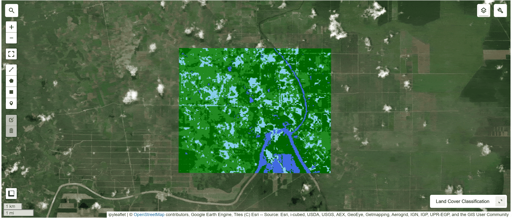
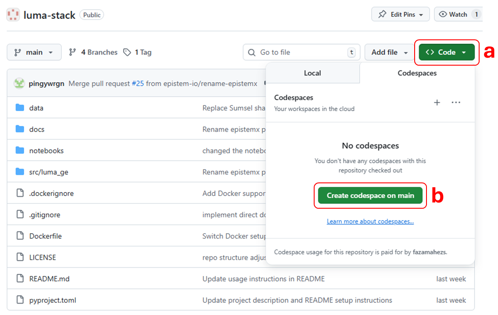

# Luma Geospatial Engine

[](https://www.python.org/downloads/) [](https://github.com/epistem-io/luma-stack/issues) [](https://github.com/epistem-io/luma-stack/pulls)



Land Use Mapping for All (Luma) is an online mapping platform that integrates open-source spatial data and cloud-based computing for generating land use and land cover (LULC) maps. Luma is designed to accommodate a wide range of users through its user-friendly interface and guided steps, enabling anyone to easily produce custom LULC maps tailored to their needs.

# Overview

Luma Geospatial Engine (Luma-GE) is a Python package that serves as the geospatial engine for the Luma web application platform. The system follows a structured 7-module pipeline:

1.  **Module 1**: Ready to use Imagery Acquisition
2.  **Module 2**: Classification Scheme Definition
3.  **Module 3**: Sample Data Generation and Management
4.  **Module 4**: Sample Data Quality Analysis
5.  **Module 5**: Feature Engineering (predictor)
6.  **Module 6**: Model Training and Classification
7.  **Module 7**: Thematic Accuracy Assessment

 In addition to the core modules, additional modules are present to support wider range of analysis. These modules are as follows:

 1. **Imagery Correction**:  Radiometric (Bidirectional Reflectance Distribution Function) and Terrain correction module
 2. **Synthetic Aperture Radar (SAR)**: SAR pre-processing and acquistion modules
 3. **Multitemporal Analysis**: Light-weight wrapper modules for multitemporal LULC mapping
 4. **Post Classification Analysis**: LULC post classification processing (consistency and change analysis)

### File Structure

-   **`data/`**: Contains example datasets for testing and experimentation.
-   **`docs/`**: Contains miscellaneous supporting documents and resources.
-   **`notebooks/`**: Jupyter notebooks used for development, experimentation, and demonstrating the functionality of the core modules.
-   **`src/luma_ge/`**: This is the core Python package for this project. It contains all the backend logic, helper functions, and modules for interacting with Google Earth Engine.
-   **`Dockerfile`**: Docker build configuration.
-   **`pyproject.toml`**: The standard Python project configuration file. It defines project metadata and core dependencies for `pip`.

# Getting Started

Follow these instructions to set up and run the project on your local machine.

### 1. Prerequisites

Before you begin, ensure you have the following installed on your system:

#### System Requirements

-   **Git**: A version control system for cloning the repository. [Installation Guide](https://git-scm.com/book/en/v2/Getting-Started-Installing-Git).
-   **Python environment manager**: If you do not yet have one installed, we recommend [Miniforge](https://github.com/conda-forge/miniforge); it is lightweight, no-frills compared to Anaconda, and works well for this project. If you already have another Conda-compatible manager, you can continue using it.

To confirm these tools are available in your shell, run:

``` powershell
git --version
conda --version
```

**Warning for Windows Users: Do not add Python or Conda to your system PATH.** This causes conflicts and prevents the luma_ge environment from working correctly. For details, see [FAQ- Should I add Anaconda to the Windows PATH?](https://www.anaconda.com/docs/getting-started/working-with-conda/reference/faq#should-i-add-anaconda-to-the-windows-path).

#### Google Earth Engine Account

-   A free [Google Earth Engine account](https://earthengine.google.com/)
-   For service account authentication: A Google Cloud project with Earth Engine API enabled

### 2. Set Up the Python Environment

Choose one of the following setup methods based on your needs:

#### Option A: Install from Git

*Recommended for most users - install directly from the repository.*

**Direct install (no cloning required):**

``` bash
pip install git+https://github.com/epistem-io/luma-stack.git
```

**Or clone and install in editable mode:**

1.  Clone the repository:

    ``` bash
    git clone https://github.com/epistem-io/luma-stack.git
    cd luma-stack
    ```

2.  Install the package using pip:

    ``` bash
    pip install -e .
    ```

    This will install `luma_ge` and all its dependencies as specified in `pyproject.toml`.

3.  Usage:

    Launch Jupyter Lab to work with the notebooks:

    ``` bash
    jupyter lab
    ```

    Then open `notebooks/Module_implementation.ipynb` for a step-by-step guide on using the `luma_ge` modules.

#### Option B: Docker Container

*Best for deployment or isolated environments.*

1.  Build the Docker image:

    ``` bash
    docker build -t luma_ge .
    ```

2.  Run the container:

    ``` bash
    docker run -p 8888:8888 luma_ge
    ```

3.  Access Jupyter Lab at `http://localhost:8888` and open `notebooks/Module_implementation.ipynb` to start working with the modules.

#### Option C: GitHub Codespaces (Cloud-based, No Local Setup)

*Best for quick experimentation without local installation, or when working on different machines.*

1.  **Create a Codespace** from the repository:

    

    -   Navigate to the [luma-stack repository](https://github.com/epistem-io/luma-stack) on GitHub
    -   Click the green **Code** button (a)
    -   Select **Codespaces** tab → **Create codespace on main** (b)
    -   Wait for the environment to initialize (typically 2-3 minutes)

2.  **Start Working**:

    -   Open the `notebooks/Module_implementation.ipynb` file in VS Code's notebook editor within the Codespace.
    -   Choose the pre-configured Python environment (dependencies are already installed).
    -   Execute the cells to observe how individual modules function with their default settings and example inputs from the `/data` directory.

### 3. Run the modules

After opening `notebooks/Module_implementation.ipynb`, you can run the minimum step-by-step process to produce a land use/land cover map. The notebook contains interactive tutorials for each module:

-   Each section corresponds to one of the 7 Luma modules
-   Cell-by-cell execution with detailed explanations
-   Example outputs and visualizations
-   Customizable parameters for your study area

**For advanced development, you can modify the notebook or integrate `luma_ge` into your own custom Python script projects.**

# Troubleshooting

It is common to encounter issues during the initial setup of `luma_ge`. You can search for existing issues in the [GitHub Issues](https://github.com/epistem-io/luma-stack/issues) page to find common solutions.

If your issue is not covered, please create a new issue with a minimum explanation that includes:

-   Python version and operating system
-   Full error message and traceback
-   Minimal code (including data) example that can reproduce the issue
-   Steps you have already tried to resolve the problem

# Contributing

We welcome contributions to Luma! Here are ways you can help:

### Types of Contributions

-   Bug Reports: Submit detailed issue reports with reproducible examples
-   Feature Requests: Propose new features or enhancements
-   Code Contributions: Fix bugs, add features, or improve performance
-   Examples: Share use cases and application examples

### Development Setup

1.  Fork the repository on GitHub

2.  Clone your fork:

    ``` bash
    git clone https://github.com/YOUR_USERNAME/luma-stack.git
    cd luma-stack
    ```

3.  Create a development branch:

    ``` bash
    git checkout -b feature/your-feature-name
    ```

4.  Install development dependencies:

    ``` bash
    pip install -e ".[dev]"
    ```

5.  Make your changes and test it

6.  Commit your changes:

    ``` bash
    git add .
    git commit -m "Add: Brief description of your changes"
    ```

7.  Push to your fork and create a Pull Request

# Acknowledgement

This work is part of the **Evolving Participatory Information System for Nature-based Climate Solutions ([Epistem](https://epistem.io/))** initiative, which aims to develop an open-source landscape monitoring technology that can address multiple thematic requirements of diverse actors and stakeholders of nature-based climate solutions.

# Reference
Luma adapts methodlogies, algorithms, and tools from the various open source projects and literature.
1. Open-Source Project and Repository
 - [AcATaMa](https://github.com/SMByC/AcATaMa) (Accuracy Assessment of Thematic Maps)
 Llano, X. C., Vergara, L. K., Arias, J. A., & Galindo, G. (2026). AcATaMa: A QGIS plugin for accuracy assessment and area estimation. Applied Computing and Geosciences, 31, Article 100389. https://doi.org/10.1016/j.acags.2026.100389
- [Sentinel-1 ARD](https://github.com/adugnag/gee_s1_ard)
Mullissa, A.; Vollrath, A.; Odongo-Braun, C.; Slagter, B.; Balling, J.; Gou, Y.; Gorelick, N.; Reiche, J. Sentinel-1 SAR Backscatter Analysis Ready Data Preparation in Google Earth Engine. Remote Sens. 2021, 13, 1954. https://doi.org/10.3390/rs13101954
- [ASI](https://github.com/awesome-spectral-indices/spyndex) (Awesome Spectral Index)
Montero, D., Aybar, C., Mahecha, M.D. et al. A standardized catalogue of spectral indices to advance the use of remote sensing in Earth system research. Sci Data 10, 197 (2023). https://doi.org/10.1038/s41597-023-02096-0
- [Geemap](https://github.com/gee-community/geemap) A Python package for interactive geospatial analysis and visualization with Google Earth Engine
- [Leafmap](https://github.com/opengeos/leafmap) A Python package for interactive mapping and geospatial analysis with minimal coding in a Jupyter environment. 
2. Methodological Literature
- Phan, T. N., Kuch, V., & Lehnert, L. W. (2020). Land Cover Classification using Google Earth Engine and Random Forest Classifier—The Role of Image Composition. Remote Sensing, 12(15), 2411. https://doi.org/10.3390/rs12152411
- Poortinga, A., Tenneson, K., Shapiro, A., Nquyen, Q., San Aung, K., Chishtie, F., & Saah, D. (2019). Mapping Plantations in Myanmar by Fusing Landsat-8, Sentinel-2 and Sentinel-1 Data along with Systematic Error Quantification. Remote Sensing, 11(7), 831. https://doi.org/10.3390/rs11070831
- Gorelick, N., Hancher, M., Dixon, M., Ilyushchenko, S., Thau, D., & Moore, R. (2017). Google Earth Engine: Planetary-scale geospatial analysis for everyone. Remote sensing of Environment, 202, 18-27. https://doi.org/10.1016/j.rse.2017.06.031 
- Roy, D. P., Li, Z., & Zhang, H. K. (2017). Adjustment of Sentinel-2 Multi-Spectral Instrument (MSI) Red-Edge Band Reflectance to Nadir BRDF Adjusted Reflectance (NBAR) and Quantification of Red-Edge Band BRDF Effects. Remote Sensing, 9(12), 1325. https://doi.org/10.3390/rs9121325
- D.P. Roy, H.K. Zhang, J. Ju, J.L. Gomez-Dans, P.E. Lewis, C.B. Schaaf, Q. Sun, J. Li, H. Huang, V. Kovalsky. (2016). A general method to normalize Landsat reflectance data to nadir BRDF adjusted reflectance. Remote Sensing of Environment, 176, 255-271. https://doi.org/10.1016/j.rse.2016.01.023
- Soenen, S. A., Peddle, D. R., & Coburn, C. A. (2005). SCS+ C: A modified sun-canopy-sensor topographic correction in forested terrain. IEEE Transactions on geoscience and remote sensing, 43(9), 2148-2159. https://doi.org/10.1109/TGRS.2005.852480


