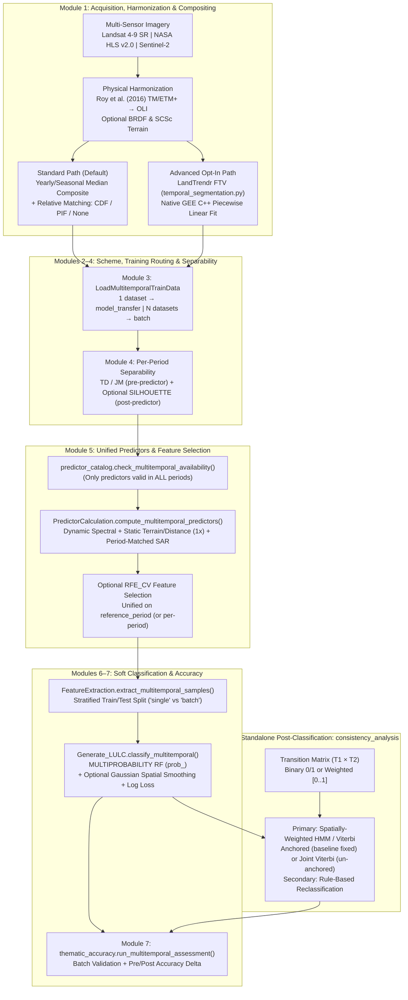

# Multitemporal LULC Mapping Methodology (`luma-ge`)

This document outlines the scientific methodology, mathematical foundations, and architectural design behind the multitemporal Land Use / Land Cover (LULC) mapping and post-classification consistency pipeline implemented in `luma-ge`.

---

## 1. End-to-End Methodology Overview

The multitemporal framework generalizes Luma's 7-module pipeline to **$N \ge 2$ chronologically ordered mapping periods** (e.g., `2015` vs. `2025`, or multi-decade series `2010 → 2015 → 2020 → 2025`) with a designated `reference_period` (default: `'baseline'`).

It supports two operational modes selected automatically from the training data provided:

| Mode | Trigger Condition | How Classification & Validation Work |
| :--- | :--- | :--- |
| **Model Transfer Mode** (`mode='model_transfer'`) | **1 training dataset** on `reference_period` (e.g., `baseline` only) | Extracts samples and trains a portable `MULTIPROBABILITY` Random Forest once on `reference_period`, then transfers the trained model across all radiometrically harmonized historical/target periods. |
| **Batch Mode** (`mode='batch'`) | **$N$ training datasets** (one per period, e.g., `historical` + `baseline`) | Runs separability, stratified feature extraction, Random Forest training/evaluation, and thematic accuracy assessment independently per period (never mixing samples across dates), while sharing a unified predictor configuration. |

---

## 2. Stage 1 — Multi-Sensor Acquisition, Physical Harmonization & Compositing

### 2.1 Supported Optical Sensors & Standardization (`data_acquisition.py`)
All sensors are cloud-masked and standardized to consistent semantic band names and `[0.0, 1.0]` floating-point Surface Reflectance (SR):
- **Landsat 4–9 Collection 2 SR (`L4_SR`–`L9_SR`):** `QA_PIXEL` cloud/shadow masking, USGS linear SR scaling (`DN * 0.0000275 - 0.2`), dropping `AEROSOL` (`SR_B1`) in multitemporal stacks to align with Landsat 4–7's 6 optical bands (`BLUE`, `GREEN`, `RED`, `NIR`, `SWIR1`, `SWIR2`).
- **NASA HLS v2.0 (`HLS`, `HLS_L30`, `HLS_S30`, 2013–present):** Combines 30 m harmonized Landsat 8/9 (`HLSL30`) and Sentinel-2 (`HLSS30`) with `Fmask` cloud/shadow/aerosol masking. GEE catalog assets are already pre-scaled `[0, 1]` surface reflectance (`scale_reflectance=False` by default) and already NBAR BRDF-normalized and bandpass-adjusted by NASA.
- **Sentinel-2 (`S2_SR`, `S2_TOA`, `S2`):** Cloud Score+ (`cs_cdf`) pixel masking, automatic pre-`2017-03-28` TOA routing, 10 standardized optical bands (including `RED_EDGE1`–`RED_EDGE4`), and `0.0001` DN-to-reflectance scaling when harmonized across periods.
- **Landsat 1–3 MSS (`L1_RAW`–`L3_RAW`):** `NIR2 → NIR` aliasing and common-band intersection when paired with later sensors.

### 2.2 Physical Harmonization (`data_acquisition.py` & `imagery_correction.py`)
Because Model Transfer relies on spectral signatures remaining physically comparable across sensors and years, three physical corrections are provided:

1. **Cross-Sensor Bandpass (RSR) Harmonization — Roy et al. (2016) (ON by default, `harmonize_landsat=True`):**  
   Landsat 8/9 OLI uses narrower spectral bandpasses (notably in `NIR`) than Landsat 4/5 TM and Landsat 7 ETM+. `Reflectance_Data.apply_brdf_harmonization()` transforms `L4_SR`, `L5_SR`, and `L7_SR` reflectance into Landsat 8/9 OLI space using Roy et al. (2016) Table 2 OLS coefficients (`OLI = slope × TM/ETM+ + intercept`):

   | Band | Slope | Intercept |
   | :--- | :---: | :---: |
   | `BLUE` | `0.9747` | `+0.0003` |
   | `GREEN` | `0.9822` | `+0.0033` |
   | `RED` | `0.9739` | `+0.0005` |
   | `NIR` | `1.0113` | `+0.0019` |
   | `SWIR1` | `1.0071` | `+0.0040` |
   | `SWIR2` | `1.0106` | `+0.0052` |

2. **BRDF View/Sun Geometry Normalization (`BRDF_Correction`, opt-in `apply_brdf=True`):**  
   Normalizes Landsat 4–9 (`DEFAULT_OPTICAL_BANDS`) and all 10 Sentinel-2 bands (`S2_OPTICAL_BANDS`) to nadir-viewing geometry using the Ross-Thick volumetric kernel and Poortinga et al. (2018) c-factor ratios (`pred0 / pred`). Automatically skipped for HLS (already NBAR).

3. **Topographic SCSc Illumination Correction (`Topographic_Correction`, opt-in `apply_topo_correction=True`):**  
   Applies Sun-Canopy-Sensor with empirical c-correction (Soenen et al., 2005) on slopes $\ge 5^\circ$ using NASADEM (or a custom `dem`). For Sentinel-2, all 10 optical bands (`S2_OPTICAL_BANDS`, including `RED_EDGE1`–`4`) are corrected together so Red-Edge vegetation indices (`NDRE`, `IRECI`, `CIRE`) do not mix terrain-corrected `RED`/`NIR` with uncorrected Red-Edge bands.

### 2.3 Standard Median Compositing & Relative Radiometric Normalization
The **default fast path** (`temporal_segmentation=False`) builds a yearly (or custom seasonal `MM-DD`) median composite for each requested period, intersects `common_bands`, and offers three relative radiometric matching modes via `radiometric_matching` (`'cdf'`, `'pif'`, or `'none'`):

- **Whole-AOI CDF Histogram Matching (`radiometric_matching='cdf'`, legacy default `histogram_match=True`):**  
  Matches the 256-bucket empirical CDF of each non-reference composite onto `reference_period` within the AOI. Visually and numerically aligns historical and baseline distributions; best suited when overall land-cover proportions are mostly stable.
- **Unsupervised Pseudo-Invariant Feature Normalization (`PIF_Normalization`, `radiometric_matching='pif'`):**  
  Avoids distorting real land-cover change (e.g., 30% deforestation between $t_1$ and $t_2$) with zero manual polygons required:
  1. Computes per-pixel `ee.Image.spectralDistance(ref, metric)` (`'sid'` Spectral Information Divergence with `.max(1e-4)` clamp for negative dark-water Landsat C2 SR pixels, `'sam'`, or `'sed'`).
  2. Isolates the most spectrally invariant `pif_percentile`% of pixels (default `10%`) via `ee.Reducer.percentile()`.
  3. Fits a 100% server-side linear gain and offset ($y = \text{scale} \cdot x + \text{offset}$) per band via `ee.Reducer.linearFit()` strictly on PIF pixels, with a physical slope guard (`scale_bounds=(0.5, 2.0)`) falling back to identity `(1.0, 0.0)` on degenerate fits.
- **None (`radiometric_matching='none'`):**  
  Relies strictly on physical Surface Reflectance + Roy et al. (2016) + optional BRDF/SCSc (matching Hermosilla et al., 2018).

### 2.4 Optional Advanced Path: `LandTrendr` FTV Temporal Segmentation (`temporal_segmentation.py`)
For cloudy tropical historical periods (e.g., Landsat 5/7 SLC-off or residual 1-year haze spikes), users can opt into **`temporal_segmentation=True`** (`LandTrendr_fit`):

- **Why Native GEE `LandTrendr` FTV:** Runs Google Earth Engine's compiled server-side C++ algorithm (`ee.Algorithms.TemporalSegmentation.LandTrendr`) on a continuous annual harmonized median stack (delegating frame creation directly to `Reflectance_Data` and `final_Image` with zero duplicated acquisition code).
- **Shared Breakpoints Across All 6 Optical Bands:** Band 0 is an inverted segmentation driver (`-NBR` by default, or `-NDVI` / `-NDMI`, because GEE `LandTrendr` assumes disturbance = positive increase). Using `NBR` (`NIR` + `SWIR2`) avoids `NIR`'s rapid 1–3 year tropical grass/weed saturation while capturing both greenness loss and slow woody canopy-moisture recovery. All 6 bands (`BLUE..SWIR2`) are fitted to those exact shared vertices (`<band>_fit`), preserving cross-band ratio consistency for downstream spectral indices.
- **Auto-Padding & Gap Safety:** Supports 30 m Landsat SR (L4–L9 harmonized, avoiding L7 SLC-off after 2012 while using L7 in 2012 to bridge the L5→L8 gap) and HLS (`HLS_L30` for 2013–2014, merged `HLS` for 2015+). Automatically pads short spans (e.g., 2–5 years) backward to `min_years=6`, extracts only the requested target periods via O(1) length-guarded `arrayGet([year_idx])`, and unmasks pixels with `< minObservationsNeeded` observations back to the raw median composite.
- **CDF Interaction & EECU Tradeoff:** Post-FTV CDF histogram matching is skipped automatically (`histogram_matched=False`). Because `LandTrendr` loads all intermediate annual composites (`3×–10×` standard median EECU), it remains opt-in (`False` by default) and supports a pre-exported `lt_image` GEE Asset override for province/national AOIs.
- **Sanity-Check Diagnostics:** `LandTrendr_fit.sample_pixel_trajectory()` and `MultitemporalAnalysis.plot_landtrendr_trajectory()` generate LT-GEE style observed vs. fitted pixel trajectory plots (showing `<DRIVER>-identified vertex years`, observed annual scatter with downward vertex arrows, and piecewise-linear FTV fit).

---

## 3. Stage 2 — Training Data Routing & Separability Analysis (Modules 2–4)

- **Automatic Mode Detection (`SyncTrainData.LoadMultitemporalTrainData`):**
  - If only `reference_period` has training data (`{'historical': None, 'baseline': baseline_roi}`), routes to **`model_transfer`**.
  - If all $N$ periods have training data (`{'historical': hist_roi, 'baseline': baseline_roi}`), routes to **`batch`**.
  - Train/test stratified splitting is deferred strictly to Module 6 (`FeatureExtraction.stratified_split()`) so Module 3 remains a pure validation/loading stage.
- **Independent Per-Period Separability (`sample_quality.run_multitemporal_separability`):**
  - Evaluates each period with training data **independently** (never mixing historical and baseline samples).
  - Supports pre-predictor parametric separability (**Transformed Divergence `TD`** and **Jeffries–Matusita `JM`**) on optical composites, and optional post-predictor non-parametric **Silhouette Score (`SILHOUETTE`, `include_silhouette=True`)** after predictor selection.

---

## 4. Stage 3 — Unified Multitemporal Predictors & Feature Selection (Module 5)

To guarantee that Model Transfer and Batch comparisons operate on identical feature spaces:
1. **Cross-Period Availability Check (`predictor_catalog.check_multitemporal_availability`):**  
   Evaluates every catalog predictor across all $N$ periods' sensors and date ranges, marking a predictor `available=True` only when it is valid in **every** period (reporting `unavailable_periods` for UI disabling in `luma-fe`).
2. **Unified Predictor Stacking (`PredictorCalculation.compute_multitemporal_predictors`):**
   - **Dynamic spectral indices:** Filtered to indices supported by `common_bands` and computed per period.
   - **Static terrain & distance predictors:** `elevation`, `slope`, `aspect`, `landform`, `dist_roads`, `dist_coast`, and `dist_settlement` are computed **once per AOI** and attached to every period's stack.
   - **Period-matched SAR:** `Sentinel-1` (`S1_VV`, `S1_VH`, `S1_VV_VH`) and `ALOS PALSAR` (`PALSAR_HH`, `PALSAR_HV`, `PALSAR_HH_HV`) are fetched per period's date window. If a requested SAR sensor is unavailable in *any* period, its bands are automatically dropped across **all** periods (with a warning) so every period maintains identical `band_names`.
3. **Optional `RFE_CV` Feature Selection (`MultitemporalAnalysis.run_feature_selection`):**  
   Runs scikit-learn cross-validated Recursive Feature Elimination (`RFE_CV`) on `reference_period` by default (`per_period_rfe=False`) and subsets all $N$ period predictor stacks to the exact winning feature list (or runs independently per period when `per_period_rfe=True`).

---

## 5. Stage 4 — Soft Classification, Spatial Smoothing & Accuracy Assessment (Modules 6–7)

- **Feature Extraction (`FeatureExtraction.extract_multitemporal_samples`):**  
  Runs `'single'` extraction on `reference_period` (Model Transfer) or `'batch'` extraction across all $N$ periods (Batch Mode) with per-period stratified train/test splitting.
- **Soft (`MULTIPROBABILITY`) Random Forest (`Generate_LULC.classify_multitemporal`):**  
  Outputs both a hard integer `'classification'` band and per-class probability bands (`prob_<Class_Name>` when `landcover_df` is supplied, scaled `0–100%`), preserving full class-membership uncertainty for downstream HMM/Viterbi decoding.
- **Optional Simple Gaussian Spatial Smoothing (`spatial_smoothing=False` by default):**  
  When enabled (`spatial_smoothing=True`, `smoothing_radius=1`, `smoothing_sigma=1.0`), convolves the `prob_*` bands with a normalized `ee.Kernel.gaussian` *prior* to `argmax` to suppress isolated salt-and-pepper misclassifications without discarding probability magnitudes.
- **Optional Log Loss Calibration (`include_log_loss=False`):**  
  Computes multi-class log loss alongside Overall Accuracy (OA), Kappa, and User's/Producer's Accuracy to evaluate probability calibration quality.
- **Batch Thematic Accuracy (`thematic_accuracy.run_multitemporal_assessment` & `compare_accuracy`):**  
  Evaluates external validation datasets across 1 or $N$ periods and quantifies pre- vs. post-consistency correction deltas ($\Delta\text{OA}$, $\Delta\text{Kappa}$).

---

## 6. Stage 5 — Post-Classification Consistency Analysis (`post_classification.py`)

Independent single-date classifications inevitably produce ecologically impossible transitions (e.g., `Built-up → Primary Forest`). `consistency_analysis` resolves these using a user-supplied **`T1 × T2` Transition Consistency Matrix** (supporting standard binary `0`/`1` tables — including `T1 \ T2` + `Kelas` CSVs — as well as optional continuous weights $W(i \to j) \in [0, 1]$).

### 6.1 Primary Method: Spatially-Weighted HMM / Viterbi (`method='hmm'`)
Modeled after Abercrombie & Friedl (2016), Gong et al. (2017), and Hermosilla et al. (2018), each pixel's true land-cover trajectory $(c_1, \dots, c_T)$ is treated as a Hidden Markov Model where Random Forest `prob_*` bands provide emission likelihoods $P(c_t \mid x_t)$ and the consistency matrix provides transition log-weights $\log W(c_{t-1} \to c_t)$ (with forbidden transitions $W = 0$ penalized by `-1e6`). Optional 3×3 neighborhood consensus weighting (`spatial_smoothing=True`, `spatial_weight=0.25`, Gong et al., 2017) incorporates local spatial context in a single non-iterative pass.

Why **Spatially-Weighted HMM–Viterbi** over iterative 3D MAP-MRF / ICM (Cai et al., 2014)?  
Viterbi is **exact and non-iterative** (1 forward pass + 1 backtracking pass of flat per-pixel band algebra in GEE), avoiding the deep nested focal-neighborhood DAG loops that cause `User memory limit exceeded` errors in GEE under iterative ICM, while requiring zero Genetic Algorithm hyperparameter tuning ($\beta_1 \dots \beta_5$).

Two decoding modes are supported:
1. **Anchored HMM (`anchor_reference=True`):** Locks the validated `baseline` ($t_T$) map and decodes historical map(s) backward ($c_1^* = \arg\max_i [\log \tilde{P}(i \mid x_1) + \log W(i \to c_2)]$). Guarantees that baseline area statistics and accuracy remain untouched.
2. **Un-Anchored Joint Viterbi (`anchor_reference=False`):** Maximizes the joint log-probability across **all** periods simultaneously:
   $$(c_1^*, \dots, c_T^*) = \arg\max_{(c_1, \dots, c_T)} \left[ \sum_{t=1}^{T} \log \tilde{P}(c_t \mid x_t) + \sum_{t=2}^{T} \log W(c_{t-1} \to c_t) \right]$$
   Eliminates the baseline-anchor bias noted in the literature: if `baseline` contains a low-confidence noise error while `historical` is high-confidence, Joint Viterbi corrects `baseline` rather than propagating the error backward.

### 6.2 Secondary Method: Rule-Based Reclassification (`method='reclassify'` / `rules=...`)
Directly applies explicit `(from_id, to_id) -> target_id` transition rules (or snaps forbidden transitions to `to_id`), serving both as a standalone fallback for hard-only maps without `prob_*` bands and as an optional logical-rule override layer on top of HMM output (following Hermosilla et al., 2018 Section 2.5.2).

---

## 7. Key Scientific References

- **Roy, D. P., et al. (2016).** Characterization of Landsat-7 to Landsat-8 reflective wavelength and normalized difference vegetation index continuity. *Remote Sensing of Environment*, 185, 57–70.
- **Poortinga, A., et al. (2018).** An operational before-after-control-impact (BACI) designed platform for vegetation monitoring at planetary scale. *Remote Sensing*, 10(5), 760.
- **Soenen, S. A., Peddle, D. R., & Coburn, C. A. (2005).** SCSc: A modified Sun-Canopy-Sensor topographic correction in forested terrain. *IEEE TGRS*, 43(9), 2148–2159.
- **Kennedy, R. E., Yang, Z., & Cohen, W. B. (2010).** Detecting trends in forest disturbance and recovery using yearly Landsat time series: 1. LandTrendr — Temporal segmentation algorithms. *Remote Sensing of Environment*, 114(12), 2897–2910.
- **Google Earth Engine Community Tutorial:** *Pseudo-Invariant Feature Matching* (`spectralDistance` + `percentile` + `linearFit`).
- **Abercrombie, S. P., & Friedl, M. A. (2016).** Improving the consistency of multitemporal land cover maps using a hidden Markov model. *IEEE TGRS*, 54(2), 703–713.
- **Gong, W., Fang, S., Yang, G., & Ge, M. (2017).** Using a hidden Markov model for improving the spatial-temporal consistency of time series land cover classification. *ISPRS Int. J. Geo-Inf.*, 6(10), 292.
- **Hermosilla, T., Wulder, M. A., White, J. C., Coops, N. C., & Hobart, G. W. (2018).** Disturbance-informed annual land cover classification maps of Canada's forested ecosystems for a 29-year Landsat time series. *Canadian Journal of Remote Sensing*, 44(1), 67–87.
