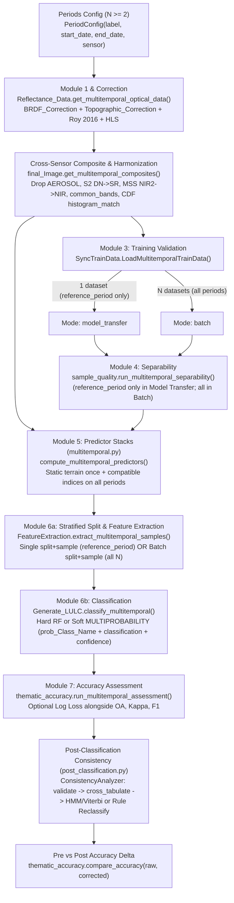

# Multitemporal Land Cover Mapping & Post-Classification Consistency Workflow

This guide summarizes the end-to-end architecture, data flow, and API usage for **multitemporal LULC mapping** and **post-classification consistency analysis** in `luma_ge` (`src/luma_ge/`).

---

## 1. End-to-End Pipeline Architecture



---

## 2. Mode Routing: Model Transfer vs. Batch Mode

The pipeline generalizes cleanly to **$N \ge 2$ chronologically ordered periods** (e.g., 2-period `historical` + `baseline`, or 4-period `2010 → 2015 → 2020 → 2025`):

| Stage | **Model Transfer Mode** (1 training dataset on `reference_period`) | **Batch Mode** ($N$ training datasets, one per period) |
| :--- | :--- | :--- |
| **Module 1 (Acquisition & Composites)** | Acquired, harmonized, intersected to `common_bands`, and **CDF histogram-matched** (`histogram_match=True` by default) to `reference_period` | Acquired and harmonized across all $N$ periods (`histogram_match` optional) |
| **Module 3 (`SyncTrainData`)** | Validates the single training dataset (`reference_period` / latest imagery); rejects single non-reference or partial counts | Validates every period's training dataset against the shared classification scheme |
| **Module 4 (`sample_quality`)** | Runs TD separability **only on `reference_period`**; skips periods without training data | Runs TD separability independently on **all $N$ periods** |
| **Module 5 (`compute_multitemporal_predictors`)** | Computes predictors on **all $N$ periods**; computes static terrain (`elevation`, `slope`, `aspect`) once; drops indices requiring bands outside `common_bands` so `inputProperties` match 100% | Computes predictors on **all $N$ periods** (each period may keep sensor-specific compatible indices) |
| **`FeatureExtraction`** | Executes **single stratified split + `sampleRegions`** on `reference_period` only via `FeatureExtraction.stratified_split()` | Executes **batch stratified split + `sampleRegions`** independently across all $N$ periods |
| **Module 6 (`Generate_LULC`)** | Trains 1 classifier on `reference_period`, evaluates on reference test split (`overall_accuracy`, optional `log_loss`), transfers via `classify_with_model()` to all other periods | Trains, evaluates, and classifies independently for every period |
| **Module 7 (`thematic_accuracy`)** | Enforces required validation periods (default `[reference_period]`); skips optional periods without ground truth | Assesses all periods that have validation data |

---

## 3. Imagery Acquisition, Radiometric & Geometric Corrections

1. **Topographic & BRDF Correction (`src/luma_ge/imagery_correction.py`)**:
   - `Topographic_Correction`: Sun-Canopy-Sensor + C (SCSc) terrain illumination correction using NASADEM (or custom DEM), masked above `sun_zenith_threshold` (default `75°`).
   - `BRDF_Correction`: MODIS RossThick–LiSparse c-factor BRDF normalization (Roy et al., 2016 / Poortinga et al., 2018) supporting both 6-band Landsat and 10-band Sentinel-2, computing sun angles dynamically from `system:time_start` and preserving scene metadata via `copyProperties`.
2. **Supported Sensors & NASA HLS v2.0 (`src/luma_ge/data_acquisition.py`)**:
   - Supports Landsat (`L1_RAW`–`L9_SR`), Sentinel-2 (`S2_SR`, `S2_TOA`), and **NASA HLS v2.0** (`HLS`, `HLS_L30`, `HLS_S30` from `2013-04-01` onward with unified `Fmask` masking and `0.0001` reflectance scaling).
   - `L4_SR`, `L5_SR`, `L7_SR` optionally receive **Roy et al. (2016) OLS TM/ETM+ → OLI** harmonization (`harmonize_landsat=True`).
   - In multitemporal composites, `AEROSOL` is automatically dropped from `L8_SR`/`L9_SR`, raw `S2_SR` (`0–10000` DN) is scaled to `[0, 1]`, and MSS (`L1_RAW`–`L3_RAW`) `NIR2` is aliased to `NIR`.
3. **CDF Histogram Matching (`final_Image.histogram_match`)**:
   - Computes server-side piecewise-linear CDF matching within `aoi` on all common optical bands of each non-reference composite **prior** to spectral index calculation so Model Transfer operates in an aligned radiometric space.

---

## 4. Soft (`MULTIPROBABILITY`) Classification, Band Naming & Metrics

- **`soft_classification(mode='multiprobability', return_model=True, class_names=scheme_df)`**:
  - Trains a single Random Forest with `setOutputMode('MULTIPROBABILITY')`.
  - Emits scaled probability bands (`prob_<Sanitized_Class_Name>` when `class_names` or `landcover_df` is provided, e.g. `prob_Hutan_Lahan_Kering`; or `prob_<id>` when omitted), plus discrete `'classification'` (`argmax`) and `'confidence'` (`max` probability in `0–100`).
- **Evaluation Metrics**:
  - **Primary**: Confusion-matrix metrics (`overall_accuracy`, `kappa`, `f1_scores`, `precision`, `recall`, `overall_gmean`) evaluated on the held-out stratified test split (`evaluate_model`) and independent ground-truth points (`thematic_accuracy`).
  - **Optional Log Loss (`compute_log_loss` / `include_log_loss=True`)**: Evaluates probability calibration directly on `MULTIPROBABILITY` predictions without discretizing via `argmax`, complementing OA for HMM consistency quality checks.

---

## 5. Post-Classification Consistency (`src/luma_ge/post_classification.py`)

`ConsistencyAnalyzer` resolves impossible temporal transitions (e.g., Urban → Primary Forest):

1. **Validate Matrix (`validate_transition_matrix`)**: Accepts `DataFrame`, CSV, or nested `dict` (`from_id × to_id`) with binary (`0/1`) or continuous weights (`0.0–1.0`) and detects missing pairs.
2. **Cross-Tabulation (`cross_tabulate`)**: Computes server-side transition areas (`past * mult + future`), filters `inconsistent_transitions`, and generates spatial `inconsistent_mask` and `inconsistent_code_image` overlays.
3. **Correction (`correct_inconsistencies` & `correct_multitemporal_sequence`)**:
   - **Primary — HMM / Viterbi Constrained MAP (`method='hmm'` / `'auto'`)**: Uses log pixel probabilities $\log P_t(c) + \log W_{i,j}$ (with `-1e6` penalty on forbidden transitions and optional 3×3 neighborhood smoothing). Supports `anchor_reference=True` (holding baseline/latest map fixed and correcting past maps backward) and `anchor_reference=False` (joint $N$-step Viterbi across all periods).
   - **Secondary — Rule-Based Reclassification (`method='reclassify'` or `rules={...}`)**: Applies explicit `(from_id, to_id) -> target_id` rules (snapping unmatched inconsistent transitions to `to_id` or keeping them under `unmatched_policy`), either as overrides on HMM outputs or as standalone fallback for hard maps.

---

## 6. Quick Start

### Option A: One-Call Orchestrator (`MultitemporalAnalysis`)

```python
from luma_ge import PeriodConfig, MultitemporalAnalysis, ConsistencyAnalyzer

mt = MultitemporalAnalysis(
    aoi=aoi,
    periods=[
        PeriodConfig("historical", 2015, 2015, "HLS_L30", cloud_cover=40),
        PeriodConfig("baseline", 2025, 2025, "HLS", cloud_cover=30),
    ],
    reference_period="baseline",
    apply_brdf=True,
    histogram_match=True,
)

result = mt.run_pipeline(
    training_sources={"historical": None, "baseline": training_fc},
    landcover_df=scheme_df,
    predictor_config={"individual_predictors": {"elevation": True, "slope": True, "spectral_indices": ["NDVI", "NDBI"]}},
    validation_by_period={"baseline": validation_fc, "historical": None},
    class_field="ID_Kelas",
    include_log_loss=True,
)

ca = ConsistencyAnalyzer()
hmm = ca.correct_inconsistencies(
    past_map=result["classification"]["maps"]["historical"],
    future_map=result["classification"]["maps"]["baseline"],
    consistency_matrix=transition_matrix,
    aoi=aoi,
    method="hmm",
    spatial_smoothing=True,
    class_names=scheme_df,
    prob_band_map=result["classification"]["prob_bands"]["historical"],
)
```

### Option B: Granular Module Calls (Stateless / Backend REST Pattern)

Call each step individually (`Reflectance_Data.get_multitemporal_optical_data` → `final_Image.get_multitemporal_composites` → `SyncTrainData.LoadMultitemporalTrainData` → `sample_quality.run_multitemporal_separability` → `compute_multitemporal_predictors` → `FeatureExtraction.extract_multitemporal_samples` → `Generate_LULC.classify_multitemporal` → `thematic_accuracy.run_multitemporal_assessment` → `ConsistencyAnalyzer`).

## Phase 8: Main Branch Predictor & RFE Integration

### Phase 8 Additions (Main Merge: `predictor_improvements` + `rfe_update`)
- **Collection Date Metadata Stamping (`data_acquisition.py`)**:
  - `get_hls_optical_data` and `get_multitemporal_optical_data` stamp `.set({'query_start_date': ..., 'query_end_date': ...})` on every returned `ee.ImageCollection`.
- **Multitemporal Predictor Availability (`predictor.py`)**:
  - `predictor_catalog.check_multitemporal_availability(periods) -> dict`: evaluates predictor availability across $N \ge 2$ periods and marks a predictor `available=True` only when available in **every** period (populating `unavailable_periods: List[str]`).
- **Multitemporal Predictors (`predictor.py` & `multitemporal.py`)**:
  - `PredictorCalculation.compute_multitemporal_predictors(...)` and `compute_multitemporal_predictors(...)` support:
    - Static terrain predictors (`elevation`, `slope`, `aspect`, `landform`) computed **once** per AOI and attached to every period's stack.
    - Static distance predictors (`dist_roads`, `dist_coast`, `dist_settlement`) computed **once** per AOI and attached to every period's stack.
    - Period-matched SAR predictors (`Sentinel-1`: `S1_VV`, `S1_VH`, `S1_VV_VH`; `ALOS PALSAR`: `PALSAR_HH`, `PALSAR_HV`, `PALSAR_HH_HV`). If a requested SAR sensor is unavailable in any period, its bands are automatically dropped across **all** periods (with a warning in `warnings`) so all period stacks maintain identical `band_names`.
- **Post-Predictor Separability (`sample_data_quality.py`)**:
  - `sample_quality.run_multitemporal_separability(..., method='TD'|'JM'|'SILHOUETTE', bands=None, include_silhouette=False)` accepts raw composites or predictor stacks (`{'predictor_stacks': ...}`) and optionally appends non-parametric `'silhouette'` scores per period when `include_silhouette=True`.
- **Optional Multitemporal RFE (`multitemporal.py`)**:
  - `MultitemporalAnalysis.run_feature_selection(...)` and `run_pipeline(..., rfe_config=...)` run `RFE_CV` (defaulting to unified selection on `reference_period` and subsetting all $N$ period predictor stacks to the winning `selected_bands`, or per-period when `per_period_rfe=True`).
- **Optional Simple Gaussian Spatial Smoothing (`classification.py` & `multitemporal.py`)**:
  - `Generate_LULC.soft_classification`, `classify_with_model`, `classify_multitemporal`, and `MultitemporalAnalysis.run_classification` accept `spatial_smoothing: bool = False`, `smoothing_radius: int = 1`, `smoothing_sigma: float = 1.0` to convolve `prob_*` bands with a normalized `ee.Kernel.gaussian` prior to `argmax`.

### Module 1 Opt-In Temporal Segmentation (`LandTrendr` FTV — `temporal_segmentation.py`)
- **Dedicated Module (`src/luma_ge/temporal_segmentation.py`)**:
  - `LandTrendrCompositor` delegates per-year frame creation directly to `Reflectance_Data` and `final_Image` (zero duplicated acquisition logic) and runs GEE's native `ee.Algorithms.TemporalSegmentation.LandTrendr` in Fitted-To-Vertex (`FTV`) mode.
  - Supports 30 m harmonized sensors (`L4_SR`–`L9_SR` with Roy 2016 harmonization and `HLS` / `HLS_L30` / `HLS_S30`), automatically padding short spans to `min_years = 6` consecutive years while preserving custom `MM-DD` seasonal windows.
  - Uses an inverted driver index (`-NBR` default, `-NDVI`, or `-NDMI`) so all 6 optical bands (`BLUE`, `GREEN`, `RED`, `NIR`, `SWIR1`, `SWIR2`) share identical temporal breakpoints, extracts target years via vertex linear interpolation (`extract_fitted_year`), and unmasks pixels with `< minObservationsNeeded` observations back to the raw median composite.
  - Skips post-FTV CDF `histogram_match` (`histogram_matched=False`), reserving CDF histogram matching for standard median composites.
- **Entry Points & Exports**:
  - `final_Image.get_landtrendr_composites(...)` in `data_acquisition.py`.
  - `MultitemporalAnalysis(..., temporal_segmentation=False, segmentation_method='landtrendr', segmentation_driver_index='NBR', segmentation_params=None, min_segmentation_years=6)` and `acquire_imagery(..., lt_image=None)` in `multitemporal.py` (falls back to standard median compositing with a warning for Sentinel-2 10 m or MSS).
  - Lazily exported as `luma_ge.LandTrendrCompositor`.
